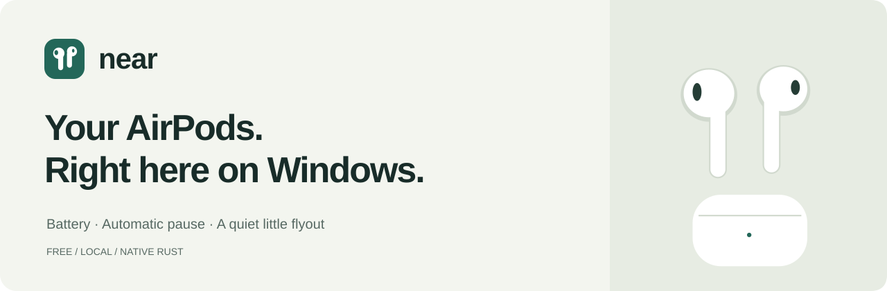

<picture></picture>

# Near

Your AirPods, right here on Windows. A small, free companion that lives in your system tray.

[**Download Near**](https://github.com/jlbjulio/Near/releases/latest) · [What's new](RELEASE.md) · [MIT license](LICENSE)

### The essentials

- **Battery at a glance.** Left, right, and case levels, with charging indicators and a tray percentage.
- **A familiar little popup.** Open your case and get a clean battery view. It fades away when you are done.
- **Connect automatically.** Near reconnects paired headphones when you take an earbud out of the case nearby; opening the case alone just shows battery. Choose Disconnect to keep them disconnected until you choose Connect again.
- **Automatic pause.** Pause when you remove an earbud; resume playback Near paused when you put it back.
- **Audio that follows your setup.** Automatic switching for directly selected AirPods. SteelSeries Sonar and other virtual mixers keep control of their routes.
- **Simple playback controls.** Play, pause, and skip without opening your music app.
- **Low battery popup.** A brief, silent reminder at 10%, once until the battery charges or recovers.
- **Ready at startup.** Enable Start with Windows once and leave Near in the tray.

No account, subscription, background web browser, or custom driver. Everything stays on your PC.

Battery is shown in Near and the system tray. Windows widgets and live tiles are not included in this release.

### Get started

1. Download the Windows release, extract the ZIP, and run **Near.exe**.
2. Pair your AirPods with this PC in **Windows Bluetooth settings** once. AirPods 4 and AirPods Pro 3 use a double-tap on the front of the open case to enter pairing mode; older cases use the setup button.
3. Click the Near icon beside the clock. Open your case to see battery updates. Near reconnects your paired AirPods when you take one out of the case.

Clicking the tray icon opens or focuses Near. Drag the flyout by its header, or press Escape or click outside to dismiss it. Settings lets you choose automatic playback, automatic switching, alerts, animations, and startup.

Near respects your selected Windows output and microphone. With automatic switching enabled, directly selected AirPods can fall back to physical speakers or a microphone when disconnected. If you use Sonar, Near leaves those virtual routes alone. Connecting from Near preserves your existing audio selection. Disconnect pauses Near’s automatic reconnection for those headphones, including after restarting Near; Connect resumes it.

### What to expect

**Windows 10 (2004+) or Windows 11, x64, with Bluetooth LE.** Detection includes AirPods 1–4, AirPods Pro 1–3, and both AirPods Max variants. Some Beats, Galaxy Buds, and headphones with a standard Bluetooth battery service are also recognized. Availability depends on your adapter, firmware, and the information your headphones broadcast; every model has not been tested with physical hardware.

AirPods battery broadcasts use **10% steps**, so Near shows **≈** rather than pretending to know an exact iPhone percentage. A closed case may stop broadcasting: Near keeps the last reading for up to ten minutes and marks it as old. Charging indicators expire when updates stop.

Near's low battery reminder is visual only. It fades away without taking focus from your current app. Your AirPods keep their own built-in battery sound.

Automatic pause supports using one or both earbuds when usable ear-sensor broadcasts are available. Near resumes only the same track it paused, within one minute. Ear sensing and switching can be limited on newer firmware; AirPods Max and AirPods Pro 3 currently provide detection and battery without an ear-sensing guarantee. If several identical AirPods are nearby, Near avoids guessing which sensor data belongs to you.

Pairing on your iPhone does not pair Windows. After the first Windows pairing, reconnecting does **not** require repeating the white-light setup. A device busy with your phone may need to be disconnected there first.

### Free and local

Near is open source under the MIT license. No telemetry, cloud service, or Apple account access. See [third-party notices](THIRD-PARTY-NOTICES.md) for library credits.

AirPods is a trademark of Apple Inc. Near is an independent project.
